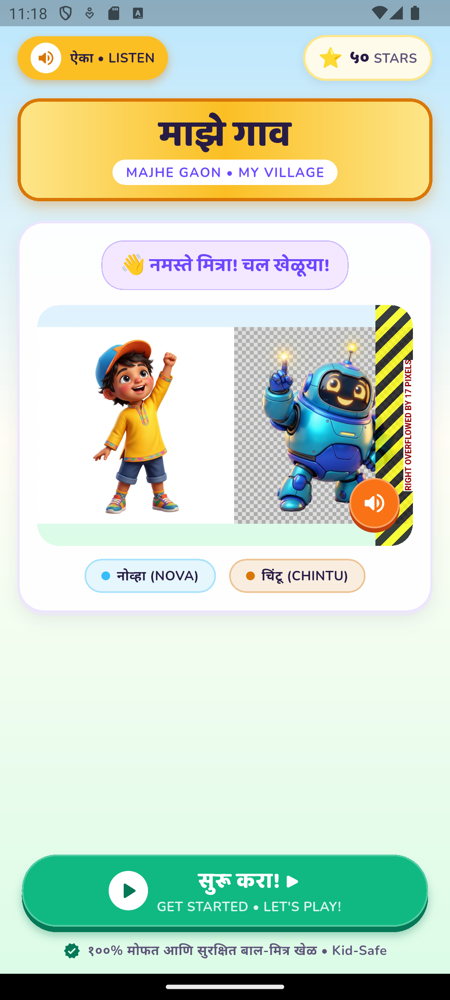

# माझे गाव (Majhe Gaon) - Educational Game UI 🎮🌾

An interactive, gamified educational Flutter application designed for children to learn and explore Marathi language and concepts through an engaging village adventure.



## ✨ Features

- **Storybook Welcome & Character Intro:** Warm, Pixar-style 3D animated village characters and guide Nova.
- **Diagnostic & Placement Quizzes:** Intuitive learning assessment suited for early learners.
- **Interactive Mini-Games:**
  - *Big vs. Small* toy game
  - *Riverbank Tap & Find* observation activity
  - *Sing & Speak* microphone / pronunciation game
  - *Picture Matching* cognitive puzzle
- **3D Illustrated Village Saga Map:** Visual roadmap of levels and milestones across the village.
- **Celebration & Rewards:** Confetti, trophies, and milestone rewards with audio feedback.
- **Sound & Audio Effects:** Dynamic sound effects powered by `audioplayers` for positive reinforcement.

## 📱 Tech Stack

- **Framework:** Flutter 3 (Dart SDK `^3.13.5`)
- **Routing:** `go_router`
- **Animations:** `flutter_animate`, `flutter_confetti`
- **Audio:** `audioplayers`
- **Typography:** `google_fonts`

## 🚀 Getting Started

### Prerequisites

- Flutter SDK (>= 3.13.5)
- Android Studio / VS Code with Flutter extension
- An Android/iOS device or emulator

### Installation

1. **Clone the repository:**
   ```bash
   git clone https://github.com/Nikhilsakpal07/majhe-gaon-app-UI.git
   cd majhe-gaon-app-UI
   ```

2. **Install dependencies:**
   ```bash
   flutter pub get
   ```

3. **Run the application:**
   ```bash
   flutter run
   ```
